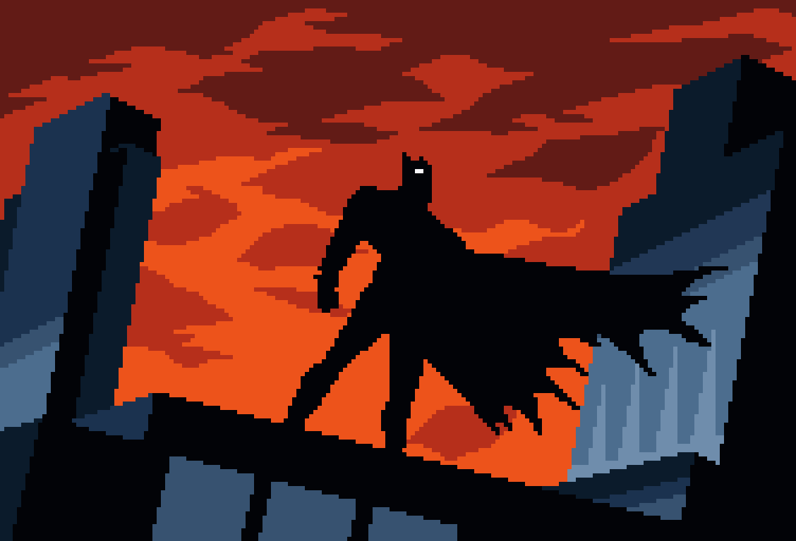

  

# About me

<!--  -->

Hi, I’m **Aftab Hussain**, a sophomore **Computer Science** student at the **Indian Institute of Information Technology, Bhagalpur**.

I have a strong passion for technology and began my development journey in high school, where I built my first project—an **Android application**. Since then, I’ve continued exploring and building across different domains of software development.

I’m particularly interested in **Competitive Programming** and **Software Development**, with a focus on **MERN Stack**, **DevOps**, **Cloud Computing**, **Generative AI**, and the **Java ecosystem**.

 

### Languages

### Technologies and Frameworks

### Tools

