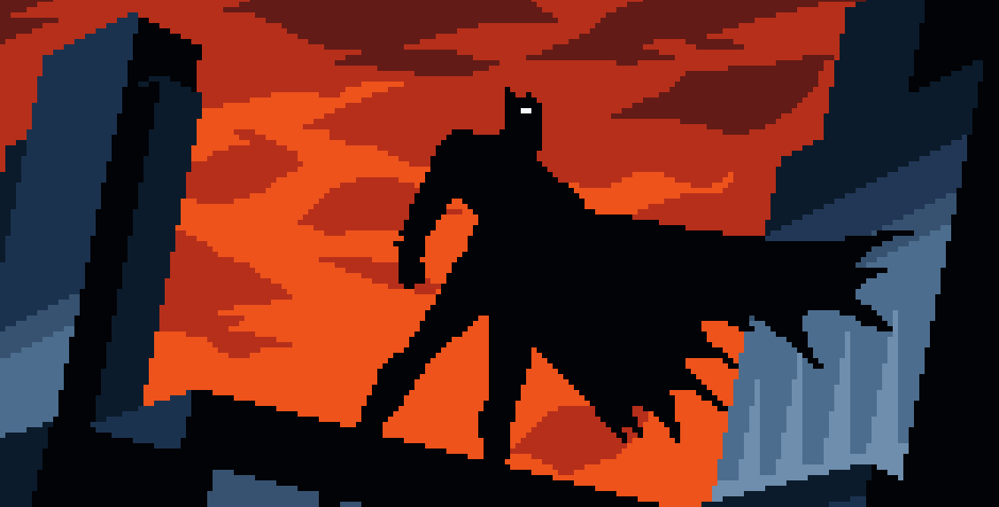

  

# About me

<!--  -->

Hi, I’m **Aftab Hussain**, a 3rd-year **Computer Science** student at the **Indian Institute of Information Technology, Bhagalpur**.

I have a strong passion for technology and began my development journey in high school, starting off with **Android Development**. Since then, I’ve continued exploring and building across different domains of software development.

I’m particularly interested in **Competitive Programming** and **Software Development**, with a focus on **MERN Stack**, **DevOps**, **Cloud Computing**, **Generative AI**, and the **Java ecosystem**.

# _aftab_hussain_

<h3 align="center">Software Engineer | Backend & Systems Enthusiast | Competitive Programmer</h3>

 

<table>
<tr>
<td width="60%" valign="middle">

### 👨‍💻 A little about me

- 🔭 **Building:** Scalable backend systems, real-time applications, and distributed services.
- 🌱 **Exploring:** System Design, Networking, WebRTC, Redis, and Cloud Infrastructure.
- ⚡ **My playground:** Turning complex algorithms into efficient solutions and making servers handle more than they signed up for.
- 🏆 **Achievements:** ICPC Asia West Regionalist | CodeChef Global Rank 203 | 3★ CodeChef.
- 💬 **Ask me about:** C++, DSA, Backend Engineering, WebRTC, Redis, and System Design.
- 📫 **Reach me:** [aftab3ne@gmail.com](mailto:aftab3ne@gmail.com)

</td>
<td width="40%" align="center" valign="middle">

</td>
</tr>
</table>

# The ToolKit

### Languages

### Technologies and Frameworks

### Tools

# Stats

  <h3>Connect with me</h3>
  
  
  
  
  
  

